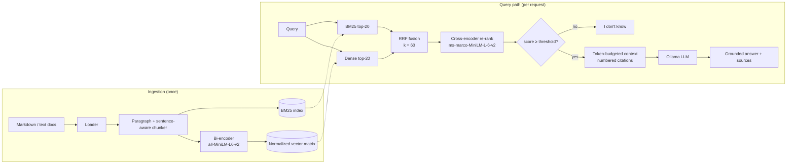

# Multi-Stage RAG Pipeline

A production-style retrieval-augmented generation (RAG) pipeline. It combines **BM25 keyword search** and **dense vector search**, merges them with **Reciprocal Rank Fusion (RRF)**, re-ranks the shortlist with a **cross-encoder**, and asks a local LLM for an answer that cites its sources.

Each stage is a separate module behind a small interface. Every stage is timed. If a stage fails, the pipeline returns a weaker result instead of crashing.

```
$ python main.py "What does error E-4012 mean?" --no-generate

Sources:
  [1] rerank=0.9999  it-support-handbook.md > Upload Error Codes
      Error code E-4012 means the upload quota for your account was exceeded. ...
  [2] rerank=0.9930  hybrid-search.md > Why Vector Search Alone Fails
      Dense embeddings compress a passage into a single vector. ...

Latency: sparse=0.1ms, dense=125.62ms, fusion=0.04ms, rerank=83.18ms, total=208.99ms
```

---

## System Architecture & Data Flow



| Stage | Module | What it does | Cost |
|---|---|---|---|
| 1. Chunking | `pipelines/chunking.py` | Keeps paragraphs whole. Splits long paragraphs only between sentences, with one sentence of overlap. Stores the markdown heading with each chunk. | Offline |
| 2a. Sparse retrieval | `core/sparse.py` | BM25 over a tokenizer that keeps IDs like `E-4012` and `user_id` as one token | ~0.1 ms |
| 2b. Dense retrieval | `core/dense.py` | Bi-encoder embeddings and cosine similarity, with `argpartition` top-k selection in O(n) time | ~100 ms (CPU) |
| 3. Fusion | `core/fusion.py` | RRF: `score(d) = Σ 1 / (k + rank_m(d))` | < 0.1 ms |
| 4. Re-ranking | `core/reranker.py` | Cross-encoder scores, turned into probabilities with a sigmoid, then a relevance threshold | ~50 ms for 20 candidates |
| 5. Context assembly | `core/context.py` | Packs chunks in relevance order under a token budget and never cuts a chunk | negligible |
| 6. Generation | `core/generator.py` | Ollama chat call that must answer only from the context and cite passage numbers | model-dependent |

`rag_pipeline/pipeline.py` connects these stages and records how long each one takes.

---

## Design Decisions

**Why hybrid search?** Dense embeddings squeeze a whole passage into one vector. Rare tokens such as error codes, SKUs and function names barely change that vector. BM25 gives those rare exact matches a high score. The reverse is also true: BM25 can't match paraphrases ("make my API faster" vs. "reducing endpoint latency"), and dense search can. Each method covers what the other misses.

**Why RRF instead of score normalization?** BM25 scores have no upper bound and depend on corpus statistics. Cosine similarity always falls in [-1, 1]. Min-max normalization depends on the best and worst score in each result list, so one outlier changes every other score. RRF uses only rank positions, so it needs no per-corpus tuning. It also rewards chunks that both retrievers rank highly.

**Why two stages instead of only a cross-encoder?** A cross-encoder needs one transformer forward pass for every (query, passage) pair, so its cost grows with corpus size on every request. A bi-encoder embeds the documents once, ahead of time. The pipeline uses the cheap retrievers to narrow the corpus to about 20 candidates. The expensive model then scores only those 20.

**Why sigmoid scores and a threshold?** MS MARCO cross-encoders output raw logits. A threshold on a logit is hard to interpret. A sigmoid turns the score into a probability, so `RAG_RERANK_MIN_SCORE=0.1` has a clear meaning. If no chunk reaches the threshold, the pipeline answers *"I don't know based on the provided documents"* and never calls the LLM. This is the main guard against hallucination.

**Why no fixed-size chunking?** Splitting every N characters can cut a sentence in half. It can also separate a claim from its qualifier ("...is supported. **Except** on Windows."). The chunker never splits a sentence. Short paragraphs in the same section are combined. Markdown headings are stored with each chunk and included in the indexed text, so short chunks still carry their topic.

---

## Failure Handling

| Failure | Behaviour |
|---|---|
| Re-ranker raises an error or returns the wrong number of scores | Logs the error, falls back to the RRF order, and adds a `warnings` entry |
| No chunk passes the relevance threshold | Returns the refusal answer and skips the LLM |
| Ollama is unreachable, times out or returns an empty or malformed response | Returns the retrieved sources with `answer: null` and a warning |
| Query is empty, only whitespace, or longer than 2,000 characters | `ValueError` from the CLI, HTTP 422 from the API |
| Missing or empty docs directory, unreadable files | Clear error at startup. Unreadable files are logged and skipped. |
| Invalid configuration (e.g. `final_top_k > rerank_candidates`) | Rejected when `Settings` is created |

---

## Getting Started

**Prerequisites:** Python 3.10+. [Ollama](https://ollama.com) is optional and only needed for generated answers. Retrieval works without it.

```bash
git clone https://github.com/Gamey001/multi-stage-rag-pipeline.git
cd multi-stage-rag-pipeline

python3 -m venv venv
source venv/bin/activate          # Windows: venv\Scripts\activate
pip install -r requirements-dev.txt

cp .env.example .env              # adjust settings if needed
```

To get generated answers, pull a model and keep Ollama running:

```bash
ollama pull llama3.2
ollama serve
```

The embedding model (~90 MB) and the re-ranker (~90 MB) download from Hugging Face the first time you run the pipeline.

### CLI

```bash
python main.py "How do I reset my laptop but keep my files?"
python main.py "Why use RRF?" --no-generate --top-k 2
python main.py "..." --docs path/to/your/docs -v
```

### HTTP API

```bash
uvicorn rag_pipeline.api.app:create_app --factory --reload
```

The server loads the models and builds the indexes once at startup. Interactive docs are at http://localhost:8000/docs.

| Method | Path | Body | Description |
|---|---|---|---|
| `GET` | `/health` | – | Status, version and number of indexed chunks |
| `POST` | `/query` | `{"query": str, "top_k"?: int, "generate"?: bool}` | Full pipeline, including the LLM answer |
| `POST` | `/retrieve` | `{"query": str, "top_k"?: int}` | Retrieval and re-ranking only |

```bash
curl -s localhost:8000/query -H 'content-type: application/json' \
  -d '{"query": "What does error E-4012 mean?"}' | jq
```

Each response includes `answer`, `sources` (with each chunk's stage and score), `timings_ms` per stage, and `warnings`.

---

## Configuration

All settings are environment variables. See [`.env.example`](.env.example).

| Variable | Default | Purpose |
|---|---|---|
| `RAG_DOCS_DIR` | `data/docs` | Folder of `.md`, `.txt` and `.rst` files to index |
| `RAG_CHUNK_MAX_CHARS` | `800` | Upper bound on chunk size |
| `RAG_CHUNK_OVERLAP_SENTENCES` | `1` | Sentences repeated between chunks when a long paragraph is split |
| `RAG_EMBEDDING_MODEL` | `sentence-transformers/all-MiniLM-L6-v2` | Bi-encoder |
| `RAG_RERANKER_MODEL` | `cross-encoder/ms-marco-MiniLM-L-6-v2` | Cross-encoder |
| `RAG_SPARSE_TOP_K` / `RAG_DENSE_TOP_K` | `20` / `20` | Candidates from each retriever |
| `RAG_RRF_K` | `60` | RRF constant. A higher value gives top ranks less advantage. |
| `RAG_RERANK_CANDIDATES` | `20` | Size of the fused shortlist sent to the cross-encoder |
| `RAG_FINAL_TOP_K` | `3` | Chunks passed to the LLM |
| `RAG_RERANK_MIN_SCORE` | `0.1` | Relevance probability threshold |
| `RAG_CONTEXT_MAX_TOKENS` | `1500` | Context budget (estimated at about 4 characters per token) |
| `RAG_GENERATION_ENABLED` | `true` | Turns the LLM stage on or off |
| `OLLAMA_BASE_URL` / `OLLAMA_MODEL` | `http://localhost:11434` / `llama3.2` | LLM endpoint and model |

---

## Project Structure

```
rag_pipeline/
├── config.py             # Settings loaded from the environment, validated at startup
├── schemas.py            # Document, Chunk, ScoredChunk
├── pipeline.py           # Connects the stages and records per-stage latency
├── pipelines/
│   ├── loader.py         # Recursive document loader
│   └── chunking.py       # Paragraph- and sentence-aware chunker
├── core/
│   ├── sparse.py         # BM25 retriever
│   ├── dense.py          # Bi-encoder retriever and Embedder protocol
│   ├── fusion.py         # Reciprocal Rank Fusion
│   ├── reranker.py       # Cross-encoder scorer, threshold and fallback
│   ├── context.py        # Token-budgeted context assembly
│   └── generator.py      # Grounded Ollama generator
└── api/app.py            # FastAPI app factory
data/docs/                # Sample corpus
tests/                    # Unit and integration tests (no model downloads)
main.py                   # CLI
```

The embedder, re-ranker and generator are defined as `Protocol`s. This lets the tests swap in small deterministic fakes, and you can switch to another model or provider (OpenAI embeddings, Cohere Rerank, a hosted LLM) without changing the pipeline code.

---

## Testing

```bash
pytest            # 53 tests, < 1 s, no network or model downloads
ruff check . && ruff format --check .
```

The tests use a hashing bag-of-words embedder and a token-overlap re-ranker instead of real models. They cover sentence-boundary chunking, the RRF formula and its edge cases, re-ranker fallback, the refusal path, Ollama error handling (with `httpx.MockTransport`) and API validation. CI runs lint and tests on Python 3.10 and 3.12.

---

## Known Limitations & Roadmap

- **Small cross-encoders miss some negations.** On the sample IT handbook, `ms-marco-MiniLM-L-6-v2` scores *"reset… **without** wiping my documents"* at 0.9976 against the *wipe* passage and 0.9955 against the *preserve* passage. Both are very high, and the ranking is wrong. A larger re-ranker (`BAAI/bge-reranker-large`) or query rewriting is the next step. Re-ranking still reliably removes off-topic chunks.
- **The vector index is in memory.** That suits a few thousand chunks. Larger corpora need a persistent ANN index (ChromaDB, pgvector or FAISS HNSW) behind the same `search()` interface.
- **Token counts are estimates.** Exact budgeting would use the target model's tokenizer.
- **Next:** an evaluation harness (context precision, groundedness, answer relevance), query rewriting, semantic caching and tracing with OpenTelemetry or Arize Phoenix.
